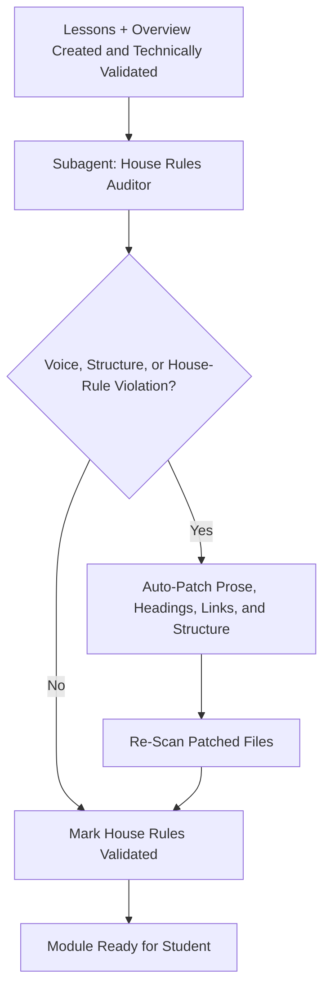

# Notes Validate House Rules

Use this skill as the dedicated editorial auditor for lesson files and module `overview.md` files. It validates **how** the material is written (voice, rhythm, structure, and house rules), while `notes-validate-coding-lessons` and `notes-validate-general-lessons` validate **whether the material is technically or factually true**.

> [!CAUTION]
> **WORKSPACE PATH ENFORCEMENT (CRITICAL)**:
> This skill audits **only the target module** (e.g., `./01-module/`) plus its related root tracking files inside the user's **active project workspace (Current Working Directory)**.
> **NEVER** inspect or edit files inside `~/.agents/` or `~/.gemini/`.

> [!IMPORTANT]
> **MANDATORY DISTINCT SUBAGENT ENFORCEMENT**:
> The house-rules auditor MUST be a **completely different, freshly invoked subagent instance** from both the lesson creator and the technical/craft validator.
> **NEVER** let the creator or the fact-checker audit its own prose. An independent third subagent guarantees unbiased enforcement of voice and formatting rules.

---

## 1. Audit Workflow



### House Rules Auditor Subagent
- **Role**: `Module House Rules Auditor`
- **Scope**: All lesson files (`01-*.md` through `0N-*.md`), the module `overview.md`, and the module's navigation consistency.
- **Does NOT**: Verify code syntax, API versions, science, or facts. Those belong to the technical/craft validators.

---

## 2. House Rules Checklist (Strict)

1. **Teaching Stance**:
   - The voice is one practitioner teaching another: patient, grounded, direct.
   - No condescension. Ban phrases like `as you obviously know`, `clearly`, `simply just`, or `everyone knows`.
   - For craft topics, the artisan-to-apprentice stance; for code topics, the dev-to-dev stance.
2. **Banned AI-isms & Filler**:
   - Remove all of: `The big win:`, `In a nutshell:`, `Key takeaway:`, `At the end of the day:`, `Let's break it down:`, `In summary:`, `To summarize:`, `Dive into`, `unlock`, `game-changer`, `supercharge`, `seamless`, `robust` (when used as filler), and similar marketing buzzwords.
   - Replace them with direct statements of fact.
3. **Paragraph Architecture**:
   - No paragraph exceeds 4 sentences.
   - Blank lines separate paragraphs. No walls of text.
   - Split overlong paragraphs rather than trimming meaning.
4. **Zero Unexplained Jargon**:
   - Every technical or trade term is defined in plain English on first use.
   - Never stack 3 or more new terms in one paragraph.
   - Acronyms are expanded on first use.
5. **Heading Discipline**:
   - No meta-label or business-pitch prefixes: `The Pain Point:`, `The Failure:`, `The Mental Shift:`, `The Status Quo:`, `Why This Matters:`, `The Big Idea:`.
   - Headings describe the mechanism, material, or craft directly in natural Title Case.
6. **No Sign-Off Snippets**:
   - Lessons must not end with a personal aside, anecdote, "senior dev" remark, or "senior artisan" sign-off.
   - The final content is the forward transition paragraph, followed by the navigation footer.
7. **Lesson 01 Onboarding Arc**:
   - Lesson 01 covers the baseline state, why the primitive approach falls short, why the technique was invented, and the road ahead before introducing advanced mechanics.
8. **Filename Slugs (2–4 Words)**:
   - Every lesson filename is `NN-<slug>.md` where the slug is 2–4 words.
   - Rename bloated slugs (5+ words) and update all relative links in the module.
   - Reject vague 1-word slugs (`01-intro.md`, `02-basics.md`).
9. **Bidirectional Navigation**:
   - Line 1 is the back-link (`[← Back to Overview](./overview.md)` for Lesson 01, `[← Previous: ... ] | [Overview](./overview.md)` afterward).
   - The final line is the forward-link (`[Next: ... →]`), ending with `[Next: Module Overview & Quizzes →](./overview.md)` on the last lesson.
   - Every relative path resolves to a real file.
10. **Content Purity**:
    - Lesson files contain no quizzes, checkboxes, evaluations, or remediation drills. Those live exclusively in `questions.md`.
    - Learning preferences or struggle logs do not appear in lessons; they belong in root `agent_notes.md`.
11. **Mermaid Quality**:
    - Diagrams have 5–10 nodes, readable labels, and are followed by a 1–2 sentence plain-English walkthrough.
    - No raw kebab-case filenames inside graph nodes.
12. **Motif Continuity (When Recorded)**:
    - If root `agent_notes.md` records a narrative motif, each relevant lesson must advance or reference it consistently. Same names, same example, no contradictory details.
    - If no motif is recorded, do not invent one.

---

## 3. Execution Steps

1. **Load Context**:
   Read the target module's `overview.md`, all lesson files, and root `agent_notes.md`. Capture the recorded motif, if any.
2. **Run the Audit**:
   Scan every file against the checklist above. Produce a short violation list grouped by file and rule number.
3. **Auto-Patch**:
   Fix voice, filler, paragraph length, heading prefixes, slugs, links, and structural violations directly in the files. Preserve technical facts, code, measurements, and safety warnings exactly as written; if a fix would change meaning, leave the sentence and flag it to the technical/craft auditor instead.
4. **Re-Scan**:
   Confirm each patched file still has valid navigation links, intact code blocks, and no newly introduced formatting breakage.
5. **Log Validation Summary**:
   Append a concise note to root `agent_notes.md` under `## Module Progress Log`:
   ```markdown
   - **[NN-module-name]**: House rules validated by Module House Rules Auditor (voice, structure, slugs, navigation, and content purity confirmed).
   ```
6. **Report**:
   Return a compact summary to the orchestrator:
   ```text
   [HOUSE RULES] NN-module-name: PASS (0 violations) | PATCHED (N fixes across M files)
   - Rule 2: removed 3 AI-ism phrases in 02-...md
   - Rule 8: renamed 01-introduction-to-the-framework.md -> 01-framework-basics.md
   ```
